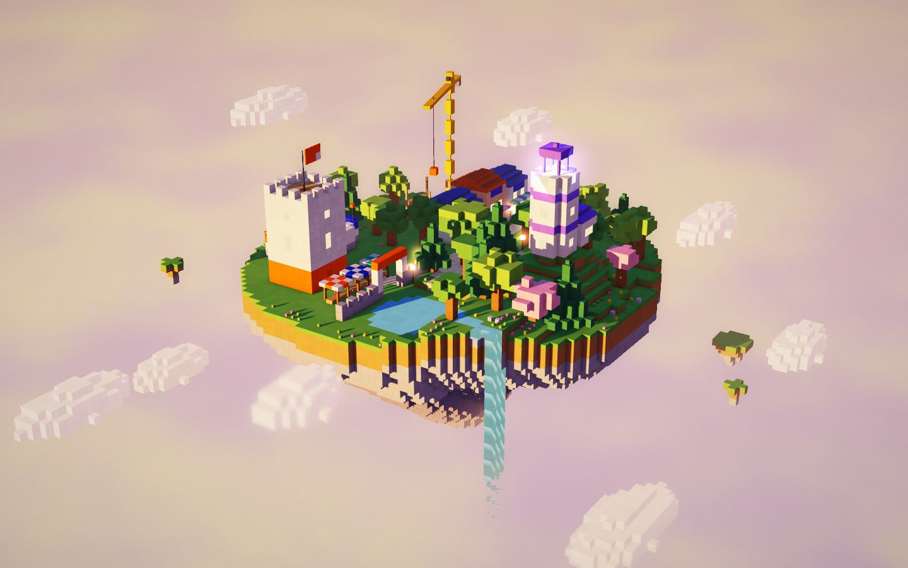

# daivik.mysterystudios.xyz

My personal site. One page, built for my application to GDG on Campus TIET (2026–27).



The page opens on an empty floating island above a sea of clouds. As you scroll, a miniature world builds itself on it, block by block.

It starts **by hand**: a few orange blocks, one at a time. Then it's **automated**, and the build speeds up, the way my own work did once I learned to work with AI tools. The camera glides past each thing I run:
- **MysteryStudios**, my freelance dev studio
- **pagewalla**, websites for local businesses
- **Vesper**, my AI assistant

At the end it pulls back to the whole finished world at golden hour.

## How it's built

- **Next.js 16** (App Router) + TypeScript, exported as plain static files (`out/`).
- **A custom WebGL2 engine**, no 3D library (`components/world/engine/`):
  - `world.ts` generates the island and every structure procedurally. Each block carries the moment in the build when it lands.
  - `index.ts` renders all ~9,000 blocks in **one instanced draw call**. It adds a **sun shadow map** (PCF) and **ambient occlusion** sampled from a live 3D occupancy texture, so the AO grows as blocks land.
  - The sky shader draws a procedural **sea of clouds**. A circle-of-confusion-weighted **depth-of-field** pass gives the tilt-shift miniature look.
  - `timeline.ts` is the story as numbers: camera keyframes (with an off-axis projection so the model sits beside the text), a morning → golden-hour lighting arc, and the scroll → build curve.
  - Scroll decides *which* blocks exist; each block's landing plays in real time, so nothing freezes mid-air when you stop scrolling.
- **Works everywhere.** The text is plain HTML and readable before any WebGL loads. Without WebGL, or with reduced motion on, the page shows stills rendered by the engine itself and crossfades between them.
- **One content file.** Every word on the page lives in `lib/content.ts`. The résumé PDF (`public/daivik-chawla-resume.pdf`) is generated from the same file with Playwright, so the two never drift apart.

## Run it

```bash
npm install
npm run dev          # http://localhost:3000
npm run build        # static site in out/
```

Generated assets (serve the build first with `node scripts/serve.mjs 4173`):

```bash
node scripts/stills.mjs /tmp/w 1440 900 0,3,6   # render exact frames of the story (?still=T)
node scripts/posters.mjs                        # fallback stills in public/world/
node --no-warnings scripts/build-resume.mjs     # résumé PDF
node --no-warnings scripts/build-og.mjs         # Open Graph image + apple icon
```

Hosted on Cloudflare Pages as static files.

Built by me, with the same tools I'd love to teach. © 2026 Daivik Chawla
